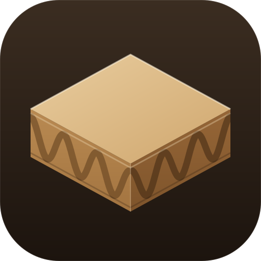
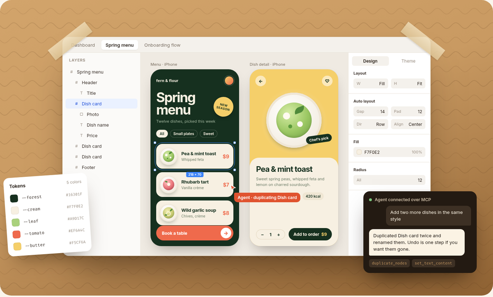

<div align="center">



# Cardboard

**Hand the pencil to your agent.**

A free, open source design editor where you and your AI agent work on the same canvas.<br />
Every layer is real HTML and CSS, and every file stays on your machine.

[Website](https://cardboard.goerll.dev) · [Download](https://github.com/goerll/cardboard/releases/latest) · [MCP docs](docs/mcp.md) · [Architecture](docs/architecture.md)

<br />



</div>

## Why Cardboard

- **Real HTML, real CSS.** Flexbox, gradients, shadows and fonts render in an actual browser engine. What you draw is what ships, and any layer exports as HTML or JSX.
- **Agents in the room.** Cardboard ships an MCP server (Model Context Protocol, the standard way AI agents call tools). Point Claude Code, Codex, Cursor or any MCP client at it and watch the agent edit your canvas live, in small steps you can steer.
- **Same canvas, same undo.** Your edits and the agent's go through one engine, so `Ctrl Z` undoes either.
- **Files you own.** Designs are plain `.cardboard` files in `~/Documents/Cardboard`. No account, no cloud, works offline. Back them up, sync them, put them in git.

## Install

**macOS and Linux**

```sh
curl -fsSL https://cardboard.goerll.dev/install.sh | sh
```

**Windows** (PowerShell)

```powershell
irm https://cardboard.goerll.dev/install.ps1 | iex
```

Run the same command again to update. The installer puts the desktop app where your system expects it (app launcher on Linux, `Applications` on macOS, Start menu on Windows) and the `cardboard` command on your PATH. Prefer to do it by hand? Grab an archive from [Releases](https://github.com/goerll/cardboard/releases/latest).

| Platform | Build | Installs to |
| --- | --- | --- |
| Linux x64 | `cardboard-linux-x64.tar.gz` | `~/.local/share/cardboard` |
| macOS Apple Silicon / Intel | `cardboard-macos-arm64.zip` / `cardboard-macos-x64.zip` | `/Applications` (or `~/Applications`) |
| Windows x64 | `cardboard-windows-x64.zip` | `%LOCALAPPDATA%\Programs\Cardboard` |

> The macOS build is not notarized by Apple yet. The install script clears the download flag so it opens normally. If you unzip it by hand, right click the app and pick **Open** the first time.

## Connect your agent

Add Cardboard as an MCP server. With Claude Code:

```sh
claude mcp add cardboard -- cardboard mcp
```

Any other MCP client takes the same command:

```json
{ "mcpServers": { "cardboard": { "command": "cardboard", "args": ["mcp"] } } }
```

`cardboard mcp` relays the agent to the running app (over a Unix socket on macOS and Linux, a named pipe on Windows). If the app isn't running, the agent's session hosts your library itself and prints an editor URL you can open to watch; start the app at any time and it takes over without dropping the agent. Pass `--no-fallback` to fail instead. To let an agent edit one file in isolation: `cardboard mcp --document design.cardboard`. If an agent can't connect, run `cardboard doctor`. The full tool list is in [docs/mcp.md](docs/mcp.md).

## Using it

- **Dashboard:** Recents, Files, Archive, Settings, search (`Ctrl F`), grid or list view, new file (`Ctrl N`).
- **Canvas:** click selects, click again drills into children, `Ctrl` click selects the deepest layer, double click edits text. Drag reorders inside auto layout; hold `Ctrl` while dragging to nest into a sibling; `Alt` drag duplicates. `Space` or middle mouse pans, `Ctrl` scroll zooms, `Shift 1` fits.
- **Tools:** `V` select, `H` hand, `F` frame, `R` rectangle, `T` text. `Ctrl /` lists every shortcut.
- **Inspector:** layout (fixed, fit, fill), flex, padding, typography, radius, fills (solid, gradient, image), borders, shadows, filters, raw CSS, HTML and JSX export.

Prefer your own browser? `cardboard serve --open` runs the same editor in a tab.

## How it works

```
┌──────────── desktop window (Chromium) or any browser ────────┐
│  React UI: dashboard, tabs, layers, inspector, canvas        │
│  canvas = same-origin iframe (your design, real Blink        │
│  layout) + transparent overlay for selection and gestures    │
└──────────────── WebSocket (127.0.0.1, random token) ─────────┘
                              │
┌──────────── Rust core ───────────────────────────────────────┐
│  library of .cardboard files, per-file undo, debounced       │
│  atomic saves, one command engine for people and agents      │
└──────── local socket ── `cardboard mcp` ── your agent ───────┘
```

- Every edit, from you or an agent, is a call into the same engine, so both share undo and show up live.
- Gestures (drag, resize, color scrubbing) preview straight in the page and commit once on release.
- The desktop app is a thin native window around that web UI, built on [CEF](https://bitbucket.org/chromiumembedded/cef) (the Chromium Embedded Framework) through [cef-rs](https://github.com/tauri-apps/cef-rs).

More in [docs/architecture.md](docs/architecture.md).

## Build from source

You need Rust (stable), Node 20+, CMake, Ninja and a C/C++ compiler. The first desktop build downloads the Chromium runtime (a few hundred MB) into `~/.cache/cardboard/cef`.

```sh
git clone https://github.com/goerll/cardboard && cd cardboard
./scripts/run-desktop.sh                     # builds the UI and desktop app, then runs it
cargo run --release -- serve --open          # or the editor in your browser
```

The server embeds `ui/dist`, so build the UI before a plain `cargo build`: `pnpm -C ui install --frozen-lockfile && pnpm -C ui build`.

```sh
cargo test && cargo clippy --all-targets -- -D warnings
pnpm -C ui dev                # Vite on :5173, proxies /ws to `cardboard serve --port 4610`
scripts/package.sh            # release archive for the current OS into dist/
```

Releases are built by [GitHub Actions](.github/workflows/release.yml) for every `v*` tag. The website in `site/` is the landing page designed in Cardboard itself, exported with [scripts/build-site.py](scripts/build-site.py) and deployed by Cloudflare Pages on every push to `main`.

## Status

Cardboard is young. Linux is where it's used day to day; the macOS and Windows builds are new, so please [open an issue](https://github.com/goerll/cardboard/issues) if something's off. Known gaps:

- Undo history lives in memory for the session.
- Each edit sends the whole document to the UI. Fine up to a few thousand layers; diffs are the next step.
- No snapping guides, components or raster export yet.

## License

[MIT](LICENSE).

Cardboard is an independent project. It is not affiliated with, endorsed by, or sponsored by Paper or any other design tool vendor. All code, text and artwork in this repository are original.
